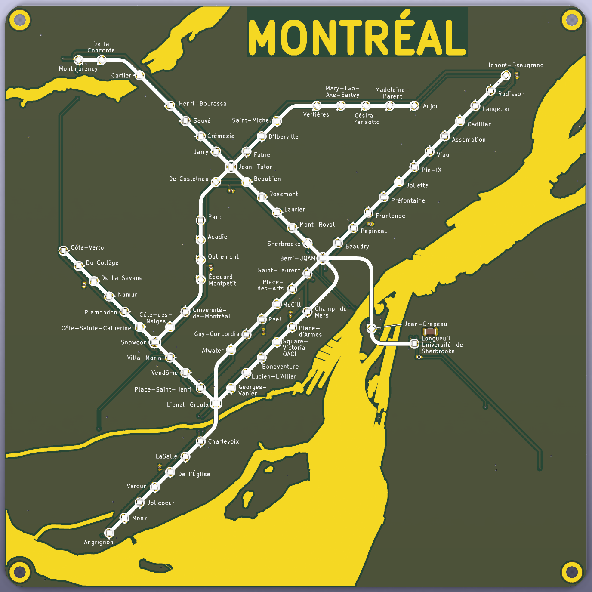
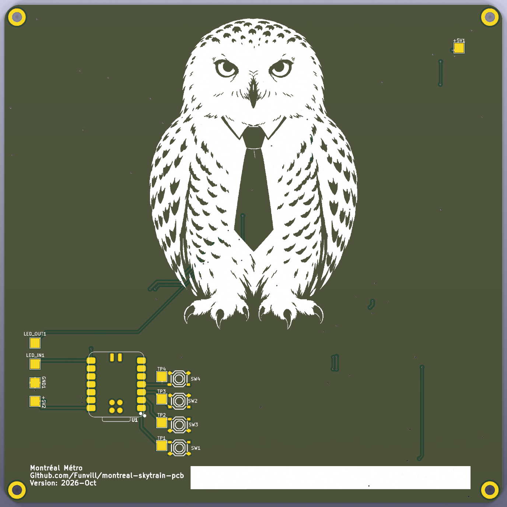

# montreal-skytrain-pcb

A printed circuit board that is a map of the Montréal Métro, with one
addressable RGB LED per station: all four lines plus the Blue line
extension to Anjou, 73 stations in all. A port of the
[Vancouver SkyTrain PCB](https://github.com/funvill/vancouver-skytrain-pcb).

**Sent to JLCPCB for manufacture on October 18th, 2026.** The files that
were uploaded are in [`manufactured/`](manufactured/)
(`jlcpcb_2026Oct18-191040.zip`, identical to the `2026-10-18-1853` outputs
in [`hardware/jlcpcb/`](hardware/jlcpcb/)).

**Front:** square 160 × 160 mm schematic map with straight lines and rounded
bends, exposed-copper (ENIG gold) water at true scale, silkscreen routes,
station rings and official station names, one XL-1615 WS2812B LED per
station.

**Back:** snowy owl in a tie, Seeed XIAO RP2040 controller (soldered by
hand), pads for four buttons, LED chain and power test points, M3 mounting
holes.

Renders are KiCad 10 `kicad-cli pcb render` output (`tools/render_board.py`).

## Where things are

| Folder | What |
|---|---|
| [`hardware/`](hardware/) | KiCad 10 project; [`hardware/README.md`](hardware/README.md) covers the board's state, regeneration and checks |
| [`hardware/jlcpcb/`](hardware/jlcpcb/) | Gerbers, BOM and pick-and-place for JLCPCB, and how they were made |
| [`manufactured/`](manufactured/) | The exact package sent to the manufacturer |
| [`input/`](input/) | Station and water data, the map builders, and the hand label placements |
| [`tools/`](tools/) | The pipeline: placement, artwork, labels, routing helpers, checks, outputs |
| [`firmware/`](firmware/) | XIAO RP2040 firmware with the STM line colours |
| [`runbook-new-city.md`](runbook-new-city.md) | How to port the board to another city |
